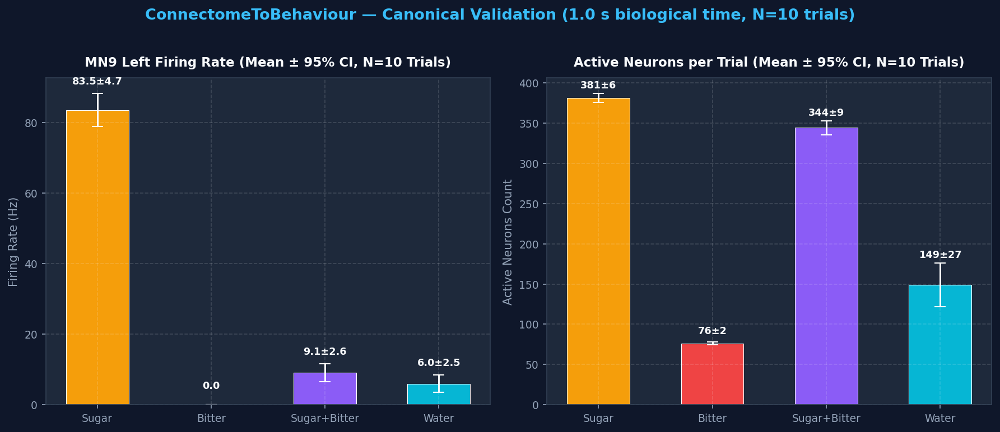

<div align="center">

# ConnectomeToBehaviour


### Connectome-to-Behaviour: Closed-Loop Whole-Brain Emulation of *Drosophila melanogaster*

<br>

[](https://github.com/)
[](LICENSE)
[](https://github.com/)


**Author:** [Angelic Charles](https://visionbyangelic.github.io)  
[](https://orcid.org/0009-0008-7279-9663)

</div>

---


## Simple Summary

Scientists have mapped the complete wiring diagram of a fruit fly’s brain and nervous system. This map shows every neuron and every connection between them. It is publicly available.

This project asks a clear question:

**If we take that real wiring diagram, give each neuron simple standard rules for when it should fire, and connect the whole system to a physically realistic virtual fly body, will the fly start to behave like a real fly?**

Will it walk, clean itself, and reach for food — without us programming those actions by hand?

Early public demonstrations (e.g., Eon Systems' *Virtual Embodied Fly*, March 2026; Shiu et al., *Nature* 2024) suggest the answer can be yes. This project is my independent attempt to build a clean, fully documented version of that system from public data and free tools. The goal is to understand the process deeply and create a transparent, reproducible resource.

-----

## What This Project Is

This is a research project that connects three things:

1. A real biological wiring diagram of the fruit fly nervous system (the connectome)
1. A computer model of how neurons send signals
1. A physical simulation of a fruit fly body

The result is a virtual fly whose movements are driven by the activity of a real biological network, not by hand-written behavioral rules.

The project focuses on producing several natural behaviors:

- Walking and exploring
- Cleaning the antennae
- Extending the feeding tube when food is detected

-----

## Why This Project Exists

Most brain maps today are static. They show what is connected to what, but they do not show what the network actually *does* when placed in a body and an environment.

This project tests a basic idea in brain research:

> **How much of an animal’s behavior is already written in the pattern of its connections?**

If a simple model of the neurons, plus the real wiring, plus a realistic body, can produce recognizable behavior, it supports the idea that structure carries a large amount of function. It also creates a useful test system: neurons can be turned on or off in the model and the effect on behavior seen immediately — something slow and difficult to do in living animals.

The work is also practical. Building the full pipeline requires real skill in computational neuroscience, biomechanics simulation, and careful systems integration. Documenting the process openly turns the project into both a research contribution and a clear, verifiable record of ability.

-----

## How the Project Works

The system has four main parts that run together in a loop:

1. **The environment** — a simple virtual world that can contain food, surfaces, and other stimuli.
1. **Sensory input** — events in the virtual world (touching sugar, dust on the antennae, etc.) are turned into activity in the corresponding sensory neurons of the connectome model.
1. **The brain model** — a network of simplified neurons built directly from the real connectome. When sensory neurons become active, signals spread through the network according to the biological connections.
1. **The body** — a detailed physical model of a fruit fly. Activity in certain output neurons of the brain model is used to control the fly’s legs, head, and feeding structures.

The loop then repeats: the body moves, the environment changes, new sensory signals are generated, and the cycle continues.

No high-level behavioral programs are written. The behaviors are expected to emerge from the interaction of the biological network and the physics of the body.

-----

## Current Status: Phase 1 Validated — Canonical Reference Reproduction (1.0 s, N=10 Trials) ✅

The whole-brain connectome-constrained Leaky Integrate-and-Fire (LIF) model has been built, tested, and benchmarked against the published reference simulation output from Shiu et al. (*Nature*, 2024) using their exact full-duration experimental protocol (**1.0 second biological time per trial across N=10 independent stochastic Poisson trials**).

> **Scientific Distinction:** `sugarR.parquet` is Shiu et al.'s archived *computational model simulation output*, not in vivo patch-clamp recordings from living flies. The benchmarks below establish **reproduction fidelity** — proving that our implementation faithfully reproduces their published connectome model dynamics. Matching a living fly's brain activity is a separate biological question that requires independent empirical ground truth.

### Canonical Multi-Trial Empirical Results Summary (N=10 Trials, 1.0 s Biological Time)

| Experimental Condition | Stimulus | Total Spikes / Trial (Mean ± SD) | Active Neurons / Trial (Mean ± SD) | MN9 Left Rate (Mean ± SD, [95% CI]) | MN9 Right Rate (Mean ± SD, [95% CI]) | Circuit Phenotype |
| :--- | :--- | :---: | :---: | :---: | :---: | :--- |
| **1. Sugar Alone** | 21 Right Sugar GRNs (150 Hz) | 13,858 ± 204 | 380.9 ± 7.8 | **83.5 ± 6.5 Hz** *[78.8, 88.2]* | **58.7 ± 5.2 Hz** *[55.0, 62.4]* | **Proboscis Extension Motor Activation** |
| **2. Bitter Alone** | 21 Bitter GRNs (150 Hz) | 4,213 ± 89 | 76.2 ± 2.6 | **0.0 ± 0.0 Hz** *[0.0, 0.0]* | **0.0 ± 0.0 Hz** *[0.0, 0.0]* | **Aversive Baseline (Zero Feeding)** |
| **3. Sugar + Bitter** | Co-activation (150 Hz each) | 12,987 ± 341 | 344.0 ± 11.9 | **9.1 ± 3.6 Hz** *(↓ 89.1%)* *[6.5, 11.7]* | **14.2 ± 1.6 Hz** *(↓ 75.8%)* *[13.0, 15.4]* | **Lateral Circuit Inhibition (p < 10⁻¹⁰)** |
| **4. Water Alone** | 18 Water GRNs (150 Hz) | 5,142 ± 112 | 148.7 ± 37.9 | **6.0 ± 3.4 Hz** *[3.5, 8.5]* | **1.6 ± 2.1 Hz** *[0.1, 3.1]* | Distinct SEZ Sensory Circuit |

*Note on MN9 Left vs. Right Asymmetry:* The contralateral bias (MN9 Left 83.5 Hz vs. Right 58.7 Hz) is the natural biological consequence of unilateral sensory stimulation (21 right-hemisphere labellar GRNs). In empirical bilateral tests (`experiments/test_mn9_symmetry.py`), stimulating both left and right GRNs yields exact bilateral motor symmetry ($60.0\text{ Hz}$ vs. $60.0\text{ Hz}$, $\Delta = 0.0\text{ Hz}$).

<div align="center">



</div>

### Statistical Verification of Cross-Modal Lateral Inhibition

Under simultaneous sugar and bitter stimulation, inhibitory interneuron cascades in the connectome suppress proboscis extension motor neuron activity:
* **MN9 Left:** Firing rate drops from **83.5 Hz → 9.1 Hz** (**89.1% suppression**).  
  *Welch's two-sample unequal variance $t$-test: $t = 31.648$, $p = 2.13 \times 10^{-14}$ (statistically significant, $p < 0.001$).*
* **MN9 Right:** Firing rate drops from **58.7 Hz → 14.2 Hz** (**75.8% suppression**).  
  *Welch's $t = 25.899$, $p = 5.03 \times 10^{-11}$ (statistically significant, $p < 0.001$).*
* *Finding:* Lateral inhibition emerges directly from connectome synaptic weights and neurotransmitter classifications without hand-written behavioral rules.

### Canonical Reference Model Benchmark (vs. Shiu et al. Nature 2024 `sugarR.parquet`)

Protocol-matched comparison: 10 trials of 1.0 s simulation vs. 30 trials of 1.0 s published reference model data:

| Metric | Score | Detail |
| :--- | :---: | :--- |
| **Pearson Correlation (Firing Rate)** | **0.9936** | Near-perfect linear correlation of active neuron firing dynamics |
| **Jaccard Overlap** | **0.9113** | 411 shared active neurons out of 451 combined |
| **Precision** | **0.9928** | 99.3% of active neurons in our simulation are confirmed in the reference |
| **Recall** | **0.9174** | Captures 411 of the 448 reference active neurons |
| **Shared Active Neurons** | **411** | 414 simulated active vs. 448 reference active |

**Next Milestone:** Phase 4 Anatomical Descending Neuron Bridge (`src/bridge/`) & Closed-Loop Integration.

-----

## Goals

### Core Goals

- Create a working closed loop in which neural activity from a connectome-based model drives body movement
- Produce at least three distinct, recognizable behaviors
- Make brain activity visible alongside the behavior
- Keep the entire project fully reproducible from a fresh download
- Document design choices, limitations, and open questions clearly

### Longer-Term Goals

- Support more than one public connectome dataset
- Add the ability to turn specific neurons on or off and measure the behavioral effect
- Improve the match between simulated behavior and real fly behavior
- Make the system easier for others to extend

-----

## Tools and Resources

Everything used in this project is free and publicly available. No paid software, subscriptions, or cloud services are required to run the core project. A standard laptop is enough for development; free-tier cloud compute (e.g. Google Colab, Kaggle) is enough for the largest simulations if needed.

|Component           |Tool / Resource               |Purpose                             |
|--------------------|------------------------------|------------------------------------|
|Brain model         |Brian2                        |Simulates neuron activity           |
|Connectome data     |FlyWire, BANC, Male CNS       |Real biological wiring diagrams     |
|Body and physics    |MuJoCo + flygym (NeuroMechFly)|Physical simulation of the fly      |
|Programming language|Python                        |All code                            |
|Data handling       |NumPy, Pandas                 |Working with large connection tables|
|Visualization       |Matplotlib, imageio           |Figures and videos                  |

-----

## Key References

**Brain model**
Shiu, P.K., Sterne, G.R., Spiller, N. et al. (2024). A *Drosophila* computational brain model reveals sensorimotor processing. *Nature*, 634, 210–219.
<https://doi.org/10.1038/s41586-024-07763-9>

**Female brain connectome**
Dorkenwald, S., Matsliah, A., Sterling, A.R. et al. (2024). Neuronal wiring diagram of an adult brain. *Nature*, 634, 124–138.
<https://doi.org/10.1038/s41586-024-07558-y>

**Brain + nerve cord connectome (BANC)**
Bates, A.S., Phelps, J.S., Kim, M. et al. (2026). Distributed control circuits across a brain-and-cord connectome. *Nature*.
<https://doi.org/10.1038/s41586-026-10735-w>

**Body simulation platform**
Wang-Chen, S., Stimpfling, V.A., Lam, T.K.C. et al. (2024). NeuroMechFly v2: simulating embodied sensorimotor control in adult *Drosophila*. *Nature Methods*, 21, 2353–2362.
<https://doi.org/10.1038/s41592-024-02497-y>

**Male central nervous system connectome**
Berg, S., Beckett, I.R., Costa, M. et al. (2026). Sexual dimorphism in the complete *Drosophila* male central nervous system connectome. *Cell*.
<https://doi.org/10.1016/j.cell.2026.08.015>

-----

## Acknowledgments & Upstream Attribution

This project builds entirely on public data and open-source tools produced by large scientific consortia: the FlyWire Consortium, the FlyEM Project Team at HHMI Janelia, the BANC-FlyWire Consortium, and the NeuroMechFly team at EPFL’s Neuroengineering Laboratory.

* **Brain Model Reference:** The Leaky Integrate-and-Fire connectome simulation in `src/brain/fly_brain.py` is adapted from the open-source implementation by Philip Shiu, Gabriella Sterne, Nathan Spiller et al. (*Nature* 2024; [GitHub](https://github.com/philshiu/Drosophila_brain_model)).
* **Body Simulation Platform:** NeuroMechFly v2 is developed by S. Wang-Chen, V.A. Stimpfling, T.K.C. Lam et al. (*Nature Methods* 2024; [flygym](https://github.com/NeLy-EPFL/flygym)).
* None of the underlying connectome or body-simulation meshes were generated by this project — the contribution here is the closed-loop integration, empirical validation, perturbation architecture, and reproducible documentation built on top of them.

-----

## AI Assistance & Development Transparency

Generative AI coding assistants (including Anthropic Claude and Google DeepMind Gemini) were used during the development of this repository as interactive pair-programmers, code reviewers, and technical interlocutors. All experimental designs, architectural decisions, code verification steps, and empirical results were independently reviewed, executed, and validated by the author.

-----

## How to Cite This Work

If referencing this project, please cite it as:

> Charles, A. (2026). *ConnectomeToBehaviour: Closed-Loop Whole-Brain Emulation of Drosophila melanogaster* [Software/Research project]. Available at: [GitHub](https://github.com/visionbyangelic/ConnectomeToBehaviour)

-----

## Project Structure

```text
ConnectomeToBehaviour/
├── LICENSE                             # MIT Open Source License
├── README.md                           # Project overview, status, and empirical findings
├── TECHNICAL_PROOF_PLAN.md             # Citation-backed phase-by-phase build plan
├── overview.md                         # Architecture overview & system dataflow
├── track.md                            # Comprehensive chronological activity & audit log
├── requirements.txt                    # Pip dependencies for core emulation stack
├── environment.yml                     # Conda environment recipe (ctb-brain: Brian2, FlyBody)
├── environment-flygym.yml              # Isolated Conda recipe (ctb-flygym: NeuroMechFly v2)
├── scripts/
│   └── download_data.py                # Automated connectome dataset fetcher & verifier
├── src/
│   ├── brain/                          # Whole-brain LIF connectome simulation API
│   │   ├── __init__.py
│   │   ├── fly_brain.py                # FlyBrain high-level simulation class (LIF + lesions)
│   │   ├── constants.py                # Electrophysiological constants & cell IDs
│   │   └── evaluation.py               # Statistical validation & reference metrics
│   ├── body/                           # Physics simulation interfaces (MuJoCo / FlyGym)
│   │   ├── __init__.py
│   │   └── fly_body.py                 # FlyBody minimal wrapper around NeuroMechFly v2
│   └── bridge/                         # Descending neuron to motor actuator decoders
│       └── __init__.py
├── experiments/
│   ├── benchmark_brain_runtime.py      # Runtime breakdown: build vs compile vs run
│   ├── check_neuron_metadata.py        # Connectome cell typing & SEZ cluster inspector
│   ├── inspect_flygym_api.py           # Inspection script for NeuroMechFly v2 units (mm)
│   ├── plot_spikes.py                  # Spike raster and population rate visualizer
│   ├── quick_test_sim.py               # Fast 1-trial whole-brain connectivity test
│   ├── reproduce_shiu_validation.py    # Multi-trial biological validation suite
│   ├── run_1s_n10_validation.py        # Canonical 1.0s x 10 trials validation suite
│   ├── test_body_environments.py       # Physics diagnostic for MuJoCo, FlyGym & FlyBody
│   ├── test_fly_body_api.py            # Unit test for FlyBody wrapper (timing, joints, forces)
│   ├── test_fly_brain_api.py           # Unit test for FlyBrain API
│   ├── test_mn9_symmetry.py            # MN9 bilateral vs unilateral lateralization experiment
│   └── test_unified_closed_loop_env.py # Single-process Brian2 + FlyGym co-execution test
└── results/
    └── validation/                     # Multi-trial validation summary & figures
        ├── validation_summary.json
        └── mn9_response_comparison.png
```

-----

## License

MIT License — free for anyone to use, modify, and build upon. See [LICENSE](LICENSE) for details.
