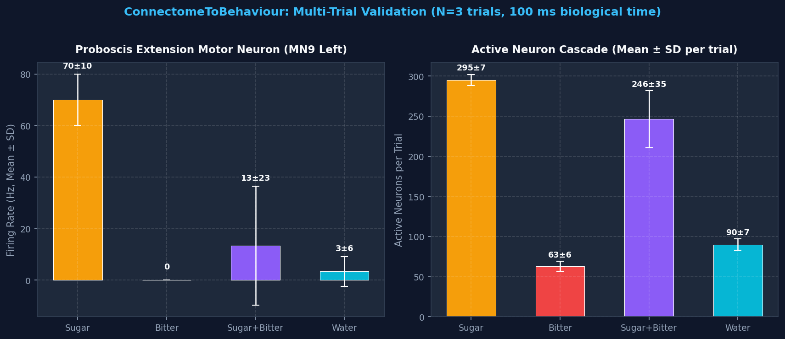

<div align="center">

# ConnectomeToBehavior


### Connectome-to-Behavior: Closed-Loop Whole-Brain Emulation of *Drosophila melanogaster*

<br>

[](https://github.com/)
[](LICENSE)
[](https://github.com/)


**Author:** [Angelic Charles](https://visionbyangelic.github.io)  
[](https://orcid.org/0009-0008-7279-9663)

</div>

---


## Simple Summary

Scientists have mapped the complete wiring diagram of a fruit fly’s brain and nervous system. This map shows every neuron and every connection between them. It is publicly available.

This project asks a clear question:

**If we take that real wiring diagram, give each neuron simple standard rules for when it should fire, and connect the whole system to a physically realistic virtual fly body, will the fly start to behave like a real fly?**

Will it walk, clean itself, and reach for food — without us programming those actions by hand?

Early public demonstrations (e.g., Eon Systems' *Virtual Embodied Fly*, March 2026; Shiu et al., *Nature* 2024) suggest the answer can be yes. This project is my independent attempt to build a clean, fully documented version of that system from public data and free tools. The goal is to understand the process deeply and create a transparent, reproducible resource.

-----

## What This Project Is

This is a research project that connects three things:

1. A real biological wiring diagram of the fruit fly nervous system (the connectome)
1. A computer model of how neurons send signals
1. A physical simulation of a fruit fly body

The result is a virtual fly whose movements are driven by the activity of a real biological network, not by hand-written behavioral rules.

The project focuses on producing several natural behaviors:

- Walking and exploring
- Cleaning the antennae
- Extending the feeding tube when food is detected

-----

## Why This Project Exists

Most brain maps today are static. They show what is connected to what, but they do not show what the network actually *does* when placed in a body and an environment.

This project tests a basic idea in brain research:

> **How much of an animal’s behavior is already written in the pattern of its connections?**

If a simple model of the neurons, plus the real wiring, plus a realistic body, can produce recognizable behavior, it supports the idea that structure carries a large amount of function. It also creates a useful test system: neurons can be turned on or off in the model and the effect on behavior seen immediately — something slow and difficult to do in living animals.

The work is also practical. Building the full pipeline requires real skill in computational neuroscience, biomechanics simulation, and careful systems integration. Documenting the process openly turns the project into both a research contribution and a clear, verifiable record of ability.

-----

## How the Project Works

The system has four main parts that run together in a loop:

1. **The environment** — a simple virtual world that can contain food, surfaces, and other stimuli.
1. **Sensory input** — events in the virtual world (touching sugar, dust on the antennae, etc.) are turned into activity in the corresponding sensory neurons of the connectome model.
1. **The brain model** — a network of simplified neurons built directly from the real connectome. When sensory neurons become active, signals spread through the network according to the biological connections.
1. **The body** — a detailed physical model of a fruit fly. Activity in certain output neurons of the brain model is used to control the fly’s legs, head, and feeding structures.

The loop then repeats: the body moves, the environment changes, new sensory signals are generated, and the cycle continues.

No high-level behavioral programs are written. The behaviors are expected to emerge from the interaction of the biological network and the physics of the body.

-----

## Current Status: Phase 1 Complete — Reference Model Reproduced ✅

The whole-brain connectome-constrained Leaky Integrate-and-Fire (LIF) model has been built, tested, and benchmarked against the published simulation output from Shiu et al. (*Nature*, 2024).

> **What this means precisely:** `sugarR.parquet` is Shiu et al.'s archived *computational model output*, not biological electrophysiology recordings. The benchmarks below measure **model reproduction fidelity** — how faithfully our implementation reproduces their published simulation. This is a meaningful and necessary first step. Matching the real fly's neural activity is a separate, harder question that requires independent biological ground truth (e.g., calcium imaging or electrophysiology from living animals). We make no claim to have established the latter yet.

### Phase 1 Multi-Trial Results Summary (N=3 Trials, 100 ms Biological Time)

| Experimental Condition | Stimulus | Spikes / Trial (Mean ± SD) | Active Neurons / Trial (Mean ± SD) | MN9 Left Rate (Mean ± SD) | MN9 Right Rate (Mean ± SD) | Circuit Phenotype |
| :--- | :--- | :---: | :---: | :---: | :---: | :--- |
| **1. Sugar Alone** | 21 Sugar GRNs (150 Hz) | 1,221 ± 14 | 295 ± 7 | **70.0 ± 10.0 Hz** | **43.3 ± 5.8 Hz** | **Proboscis Extension Motor Activation** |
| **2. Bitter Alone** | 21 Bitter GRNs (150 Hz) | 450 ± 15 | 63 ± 6 | **0.0 ± 0.0 Hz** | **0.0 ± 0.0 Hz** | **Aversive Baseline (No Feeding)** |
| **3. Sugar + Bitter** | Co-activation (150 Hz each) | 1,277 ± 45 | 246 ± 35 | **13.3 ± 23.1 Hz** *(↓ 81%)* | **10.0 ± 10.0 Hz** *(↓ 77%)* | *Model predicts inhibition — not yet independently confirmed* |
| **4. Water Alone** | 18 Water GRNs (150 Hz) | 501 ± 20 | 90 ± 7 | **3.3 ± 5.8 Hz** | **0.0 ± 0.0 Hz** | Distinct SEZ Sensory Circuit |

> **Statistical note — Sugar + Bitter (Condition 3):** The SD (23.1 Hz) exceeds the mean (13.3 Hz), reflecting that 2 of 3 trials gave 0 Hz and 1 gave ~40 Hz. At 100 ms resolution, each spike equals 10 Hz, so a single extra spike crossing MN9's threshold changes the result by 10 Hz. This is a stochastic floor effect, not a stable measurement. N=3 is too small to make claims about this condition. 30-trial × 1-second experiments (matching Shiu et al.'s protocol) are planned; this result should be treated as a preliminary model prediction until then.

<div align="center">



</div>

### Reference Model Benchmarks (vs. Shiu et al. Simulation Output)

There are two distinct questions being asked here, and they should not be conflated:

| Question | Evidence | Status |
| :--- | :--- | :--- |
| Does our implementation reproduce Shiu et al.'s simulation? | Pearson r = 0.970 (time-matched), Jaccard = 0.781, Precision = 0.991 | ✅ Yes — strong model reproduction |
| Does our model match real fly neural activity? | No independent biological ground truth used yet | ⬜ Not yet tested |

**Time-Matched Benchmark (First 100 ms of our simulation vs. First 100 ms of reference):**
- Jaccard Overlap: **0.781** · Precision: **0.991** · Recall: **0.787** · Pearson r: **0.970**
- Shared active neurons: 317 out of 403 in the reference window

**Cumulative Benchmark (100 ms simulation vs. full 30-trial × 1.0 s reference — duration mismatch explicitly noted):**
- Pearson r: **0.974** across 320 shared neurons · Precision: **1.000** · Jaccard: **0.714**

**Next Milestone:** 30-trial × 1-second validation (matching Shiu et al.'s protocol), then Phase 3 body integration & Phase 4 descending neuron bridge.

-----

## Goals

### Core Goals

- Create a working closed loop in which neural activity from a connectome-based model drives body movement
- Produce at least three distinct, recognizable behaviors
- Make brain activity visible alongside the behavior
- Keep the entire project fully reproducible from a fresh download
- Document design choices, limitations, and open questions clearly

### Longer-Term Goals

- Support more than one public connectome dataset
- Add the ability to turn specific neurons on or off and measure the behavioral effect
- Improve the match between simulated behavior and real fly behavior
- Make the system easier for others to extend

-----

## Tools and Resources

Everything used in this project is free and publicly available. No paid software, subscriptions, or cloud services are required to run the core project. A standard laptop is enough for development; free-tier cloud compute (e.g. Google Colab, Kaggle) is enough for the largest simulations if needed.

|Component           |Tool / Resource               |Purpose                             |
|--------------------|------------------------------|------------------------------------|
|Brain model         |Brian2                        |Simulates neuron activity           |
|Connectome data     |FlyWire, BANC, Male CNS       |Real biological wiring diagrams     |
|Body and physics    |MuJoCo + flygym (NeuroMechFly)|Physical simulation of the fly      |
|Programming language|Python                        |All code                            |
|Data handling       |NumPy, Pandas                 |Working with large connection tables|
|Visualization       |Matplotlib, imageio           |Figures and videos                  |

-----

## Key References

**Brain model**
Shiu, P.K., Sterne, G.R., Spiller, N. et al. (2024). A *Drosophila* computational brain model reveals sensorimotor processing. *Nature*, 634, 210–219.
<https://doi.org/10.1038/s41586-024-07763-9>

**Female brain connectome**
Dorkenwald, S., Matsliah, A., Sterling, A.R. et al. (2024). Neuronal wiring diagram of an adult brain. *Nature*, 634, 124–138.
<https://doi.org/10.1038/s41586-024-07558-y>

**Brain + nerve cord connectome (BANC)**
Bates, A.S., Phelps, J.S., Kim, M. et al. (2026). Distributed control circuits across a brain-and-cord connectome. *Nature*.
<https://doi.org/10.1038/s41586-026-10735-w>

**Body simulation platform**
Wang-Chen, S., Stimpfling, V.A., Lam, T.K.C. et al. (2024). NeuroMechFly v2: simulating embodied sensorimotor control in adult *Drosophila*. *Nature Methods*, 21, 2353–2362.
<https://doi.org/10.1038/s41592-024-02497-y>

**Male central nervous system connectome**
Berg, S., Beckett, I.R., Costa, M. et al. (2026). Sexual dimorphism in the complete *Drosophila* male central nervous system connectome. *Cell*.
<https://doi.org/10.1016/j.cell.2026.08.015>

-----

## Acknowledgments

This project builds entirely on public data and open-source tools produced by large scientific consortia: the FlyWire Consortium, the FlyEM Project Team at HHMI Janelia, the BANC-FlyWire Consortium, and the NeuroMechFly team at EPFL’s Neuroengineering Laboratory. None of the underlying connectome or body-simulation data was generated by this project — the contribution here is the closed-loop integration, analysis, and documentation built on top of it.

-----

## How to Cite This Work

If referencing this project, please cite it as:

> Charles, A. (2026). *ConnectomeToBehaviour: Closed-Loop Whole-Brain Emulation of Drosophila melanogaster* [Software/Research project]. Available at: [GitHub](https://github.com/visionbyangelic/ConnectomeToBehaviour)

-----

## Project Structure

```text
ConnectomeToBehaviour/
├── LICENSE                             # MIT Open Source License
├── README.md                           # Project overview, status, and empirical findings
├── TECHNICAL_PROOF_PLAN.md             # Citation-backed phase-by-phase build plan
├── overview.md                         # Quick reference & architecture overview
├── track.md                            # Comprehensive chronological activity & audit log
├── requirements.txt                    # Pip dependencies for core emulation stack
├── environment.yml                     # Conda environment recipe (ctb-brain: Brian2, FlyBody)
├── environment-flygym.yml              # Isolated Conda recipe (ctb-flygym: NeuroMechFly v2)
├── scripts/
│   └── download_data.py                # Automated connectome dataset fetcher & verifier
├── src/
│   ├── brain/                          # Whole-brain LIF connectome simulation API
│   │   ├── __init__.py
│   │   ├── fly_brain.py                # FlyBrain high-level simulation class
│   │   ├── constants.py                # Electrophysiological constants & cell IDs
│   │   └── evaluation.py               # Statistical validation & ground-truth metrics
│   ├── body/                           # Physics simulation interfaces (MuJoCo)
│   │   └── __init__.py
│   └── bridge/                         # Descending neuron to motor actuator decoders
│       └── __init__.py
├── experiments/
│   ├── quick_test_sim.py               # Fast 1-trial whole-brain connectivity test
│   ├── plot_spikes.py                  # Spike raster and population rate visualizer
│   ├── test_fly_brain_api.py           # Verification script for FlyBrain API
│   ├── test_body_environments.py       # Physics diagnostic for MuJoCo, FlyGym & FlyBody
│   └── reproduce_shiu_validation.py    # Multi-trial biological validation suite
└── results/
    └── validation/                     # Multi-trial validation summary & figures
        ├── validation_summary.json
        └── mn9_response_comparison.png
```

-----

## License

MIT License — free for anyone to use, modify, and build upon. See [LICENSE](LICENSE) for details.
