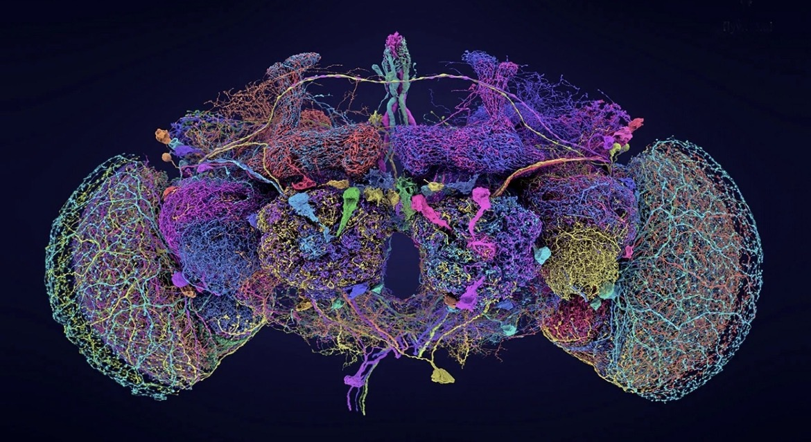

<div align="center">

# ConnectomeToBehaviour


### A complete map of a fruit fly's brain, switched on inside a computer and connected to a simulated body, to test how much of the fly's behaviour comes from the wiring itself.

<br>

[](https://github.com/)
[](LICENSE)
[](https://github.com/)


**Author:** [Angelic Charles](https://visionbyangelic.github.io)
[](https://orcid.org/0009-0008-7279-9663)

</div>

> ### 💡 The Project in Plain English
>
> Scientists have mapped a fruit fly's whole brain: every neuron, and every connection between them. This project takes that map and switches it on inside a computer. The simulated brain is connected to a simulated fly body, so it can sense the world and move, and what it does changes what it senses next, in a loop. Then comes the real test. I change the wiring on purpose: I scramble it, cut out specific pathways, and replace it with simple hand-written rules, and I watch what happens to the behaviour each time. That is how I find out how much of what the fly does is really written in its wiring, and how much comes from the extra parts I had to build around it. Where it stands: the brain is rebuilt and checked against the published model it follows, the loop is running, and the behaviour tests are being measured now.

---

## 1. What is This Project? (The Elevator Pitch)

**ConnectomeToBehaviour** is an experimental computational neuroscience project built around one simple-sounding move: take the complete wiring map of a real brain, switch it on inside a computer, and connect it to a body.

The brain is the adult fruit fly's, *Drosophila melanogaster*. Its wiring map, called a **connectome**, was published by the FlyWire Consortium: 127,400 neurons in the central brain, and every connection between them that the map records. I rebuilt that brain as a simulation in Brian2, where every neuron follows the same simple firing rule. The rule is called **leaky integrate-and-fire**: the neuron collects incoming pulses, called spikes, and fires a spike of its own when it has collected enough. The rebuild follows the published model of Shiu et al. (*Nature*, 2024).

The body is FlyBody, a physically simulated fly running in the MuJoCo physics engine through FlyGym. Brain and body are connected in both directions, and that is what makes the loop **closed**: what the body senses is turned into activity in the brain, the brain's activity is turned into movement, and the movement changes what the body senses next.

Everything in that loop except the wiring itself is something I had to build or choose: the layer that turns senses into brain activity (the encoder), the layer that turns brain activity into movement (the decoder, called the translator in this project), and the controllers built into the body. So the project exists to answer one question:

**How much of what this fly does is really written in its wiring?**

---

## 2. The Core Mystery: A Wiring Diagram Is Not a Behaviour

A road map tells you which towns are connected. It does not tell you which roads carry the ambulances.

A connectome has the same limit. It records, in extraordinary detail, which neurons are connected to which. It does not say which of those connections a behaviour actually depends on. Most connections might be essential to it, or most might be decoration as far as that behaviour is concerned, and the map alone cannot tell you which.

There is a second trap, and it is the one this project is built to avoid. Suppose the simulated fly behaves: it tastes sugar and extends its proboscis (its feeding tube) to feed. It is tempting to announce that the wiring produced the behaviour. But on its way out, the behaviour passed through every layer I built around the brain: the input layer, the output layer, the controllers inside the simulated body. Any of those could be doing the real work, with the famous wiring diagram acting as little more than a passenger.

So the mystery is not whether a whole brain can be switched on inside a computer. It can. The mystery is how you would ever know which part of the machine deserves the credit.

---

## 3. The Living Brain vs. the Brain in This Computer

This project uses the real wiring, but it is not the living brain, and the difference matters enough to put in a table.

```
┌──────────────────────────────────────────────┬──────────────────────────────────────────────┐
│ WHAT THE MODEL KEEPS                         │ WHAT IT SIMPLIFIES OR LEAVES OUT             │
├──────────────────────────────────────────────┼──────────────────────────────────────────────┤
│ The real wiring diagram, with every          │ One simple firing rule for every             │
│ mapped neuron and connection                 │ neuron. Real neurons differ by type          │
│                                              │                                              │
│ Spiking activity: neurons                    │ No learning or plasticity: the               │
│ communicate in brief pulses                  │ wiring never changes itself                  │
│                                              │                                              │
│ A physical body under simulated              │ No hunger, thirst, or other                  │
│ physics, not a cartoon                       │ internal states                              │
│                                              │                                              │
│ A closed loop: what the body senses          │ Taste built from physical contact,           │
│ drives the brain, and movement               │ not from real taste organs                   │
│ changes what it senses next                  │                                              │
│                                              │                                              │
│ Interventions on the actual wiring           │ One behaviour studied at a time              │
└──────────────────────────────────────────────┴──────────────────────────────────────────────┘
```

Everything in the right-hand column is a choice I made or a limit I accepted. Each one is written down in the project's preregistrations (the documents, kept in this repository, where each experiment is specified in full before it runs), because each one could change the answer.

---

## 4. The Central Question

> *With the neuron rules, the body, and the input and output layers held fixed, how does a behaviour change, and by how much, when the wiring itself is changed?*

I ask it three ways. Each way has a name, because each one is measured and reported separately.

**E-Total: the effect of the specific wiring as a whole.** The intact wiring is compared against scrambled versions of itself. The scrambled versions keep the same connection statistics (the same overall number and strength of connections) but destroy the specific pattern of who connects to whom. If the behaviour survives scrambling, the specific pattern was not doing the work.

**E-Pathway: the effect of one pathway.** The pathway a behaviour depends on is cut, and the result is compared against matched cuts of the same size made in parts of the brain the behaviour should not need. A pathway only earns its name if cutting it hurts more than cutting somewhere else.

**E-Baseline: the effect of having the wiring at all.** The intact brain is compared against simple hand-written rules driving the same body, with no connectome involved. If a handful of rules can match the brain, then for that behaviour the wiring was not doing much.

---

## 5. The Experiment: Changing the Wiring on Purpose

For each behaviour, the same test is run four ways:

1. **Intact.** The real wiring, untouched.
2. **Scrambled.** The wiring shuffled, keeping its overall statistics.
3. **Cut.** The behaviour's pathway removed, alongside matched control cuts elsewhere.
4. **Rules.** No wiring at all: simple hand-written rules driving the body.

Everything else is held identical across the four: the same body, the same translator, the same conditions, the same way of measuring the behaviour. Only the wiring changes. That is the whole design, and it is what makes the conclusion possible: if the behaviour changes, the change can only have come from the wiring, because nothing else was allowed to move.

One more thing is fixed in advance: what counts as "the same". If a changed wiring produces behaviour that falls inside the bounds set before the run, the honest conclusion is that the behaviour does not depend on the wiring in that way, at that resolution. Equivalence is a result, not a failed experiment, and it will be reported as one.

---

## 6. Meet the System

Four components, and only one of them is biological.

```
┌──────────────────────────────────────────────────────────────────────────┐
│ THE WIRING                                                               │
│                                                                          │
│ The FlyWire connectome, materialisation v630: the complete map of the    │
│ adult fruit fly central brain, built from electron microscope images     │
│ by the FlyWire Consortium. About 14.7 million connections between        │
│ 127,400 neurons. Public data; none of it was generated by me.            │
├──────────────────────────────────────────────────────────────────────────┤
│ THE BRAIN                                                                │
│                                                                          │
│ All 127,400 neurons from the wiring map, each one simulated as a         │
│ leaky integrate-and-fire neuron in Brian2, following the published       │
│ model of Shiu et al. (Nature, 2024). A leaky integrate-and-fire          │
│ neuron is the standard simple neuron: it collects incoming pulses,       │
│ and fires its own pulse when it has collected enough.                    │
├──────────────────────────────────────────────────────────────────────────┤
│ THE TRANSLATOR                                                           │
│                                                                          │
│ The decoder. It reads the activity of the feeding pathway inside         │
│ the brain and turns it into movement of the proboscis, the fly's         │
│ feeding tube. It is calibrated on separate data and then frozen          │
│ before any test runs, so it cannot be adjusted to flatter a result.      │
├──────────────────────────────────────────────────────────────────────────┤
│ THE BODY                                                                 │
│                                                                          │
│ FlyBody, a physically simulated fruit fly running in the MuJoCo          │
│ physics engine through FlyGym. It has 102 actuators (the simulated       │
│ equivalent of muscles), and its proboscis has 5 moving parts. It         │
│ feels the world through contact, and the taste signal used in this       │
│ project is constructed from those contact events, and is labelled        │
│ as constructed wherever it appears.                                      │
└──────────────────────────────────────────────────────────────────────────┘
```

---

## 7. The First Behaviour: Feeding

Feeding comes first, for one reason: its pathway can be followed through the wiring, step by step.

In a living fly, taste neurons on the mouthparts and legs detect chemicals such as sugar and bitter compounds. Their signal travels into the brain, through a chain of interneurons (neurons whose job is to pass signals between other neurons), and reaches a pair of motor neurons called **MN9**. MN9 drives the **proboscis**, the fly's feeding tube: when MN9 fires, the proboscis extends and the fly feeds. Every step of that chain exists as named neurons in the wiring map, which makes feeding the cleanest behaviour in this project to test.

Before the wiring experiment itself, I am measuring the baseline: how the rebuilt brain responds to four taste conditions on their own. Sugar. Bitter. Sugar and bitter together. And water. The question inside the baseline is one a living fly answers every day: **does bitter quiet the brain's answer to sugar, and by how much?** In the living animal, bitter suppresses feeding. Whether this model shows the same suppression, and how strong it is, is one of the first things the baseline will say.

Walk and halt behaviour comes after feeding: whether the model stops walking when it feeds, the way real flies do.

---

## 8. How the Claims Are Kept Honest

- **Everything is decided before it is run.** For each experiment, the comparisons, the measurements and the decision rules are written down and frozen in advance, in preregistrations kept in this repository. Nothing about a test is adjusted after its results are seen.
- **The translator cannot be tuned to the answer.** It is calibrated on separate data and frozen before testing. As a control, tests are also run with a translator refitted to each changed wiring, so a frozen translator can neither hide an effect nor invent one.
- **Every behaviour gets a receipt.** For each result, I keep a record of which parts came from the wiring and which came from the layers I added, so the credit, and the blame, are assigned openly.
- **The claims are about the model.** Every conclusion is stated as a conclusion about this simulated brain, under these documented choices. Nothing is claimed directly about a living fly.

---

## 9. Status

- The brain has been rebuilt from the published sources, and validated against the published model's own output.
- The simulated body was audited for what it can honestly express, and qualified for the feeding behaviour.
- The closed loop, brain to body and back again, is built and running.
- The taste baseline (sugar, bitter, both together, and water) is being measured now.
- Next comes the feeding wiring experiment: intact, scrambled, cut, and rules. Walk and halt behaviour follows.

---

## 10. Limitations and Boundaries

- **The claims are model-conditional.** They describe this simulated brain under the choices documented here and in the preregistrations, not the living animal.
- **The neuron model is deliberately simple.** Every neuron uses the same standard firing rule. Real neurons differ by type, and those differences are not in this model.
- **Taste is constructed.** The body has no real taste organs. The taste signal is built from physical contact events, and it is labelled as constructed everywhere it is used.
- **Feeding happens on a raised surface.** With its neck held at its resting pose, the registered body cannot quite reach food placed at ground level, so feeding is demonstrated on a low platform within its reach. This is stated wherever the feeding work is described.
- **There are no internal states.** No hunger, no thirst, no learning, and no memory that outlasts a run. The wiring never changes itself.
- **This is not emulation, uploading, or consciousness.** It is a test of what wiring contributes to behaviour, and it makes no claim beyond that.
- **Null results count.** Equivalence and null outcomes will be reported with the same care as differences, together with the bounds they were measured within.

---

## 11. Future Work

1. **Walk and halt.** The same wiring experiment applied to walking, and to whether the model halts in order to feed.
2. **A brain-and-cord circuit.** The BANC connectome maps the brain together with the nerve cord. A later stage takes one bounded circuit from it, for one behaviour's pathway, as a stretch goal behind the core work.
3. **The comparison against the first build.** The first version of this project, preserved in this repository, gets a formal, like-for-like comparison once the core experiments are complete.
4. **Publication.** A preprint as soon as the feeding experiment is complete, whatever its outcome, then the paper.

---

## 12. Frequently Asked Questions

**Q: Is this the real fly brain?** A: It is the real wiring map of the fly's central brain, run under simple, standard neuron rules. So it is a model of the brain built from the brain's actual connections, not a copy of the living organ.

**Q: Is this mind uploading, or emulation?** A: No. The project tests how much of a behaviour the wiring accounts for. It says nothing about consciousness, and it does not claim to reproduce the living brain.

**Q: Why a fruit fly?** A: Because it is the animal we have this for: a complete map of an adult brain, published models to build on, and behaviours whose pathways can be followed through the map. What is learned here about testing wiring claims applies wherever connectomes go next.

**Q: What if the wiring turns out not to matter much?** A: Then that is the result. The experiments are designed so that this answer is measurable, with bounds, and it would be reported exactly as a positive result would be. It would mean the behaviour lives in the layers around the wiring, which is itself a finding worth having.

---

## 13. Why This Matters

Fruit flies are the beginning, not the end. Connectomes are being built for larger and larger brains, and every new map will arrive with the same question attached: now that we have the wiring, what does it explain?

Answering that question badly is easy: switch the map on, watch it move, and credit the wiring. This project is an attempt to answer it properly, on the one complete adult brain map available today, where the system is still small enough that every layer around the wiring can be documented and every claim can be checked. The test itself, and the habit of accounting for which layer did what, are built to travel to whatever connectome comes next.

---

## Tech Stack & Reproducibility

**Brain:** Python and Brian2, simulating 127,400 leaky integrate-and-fire neurons wired by the FlyWire connectome (materialisation v630; public data from the FlyWire Consortium and the Shiu et al. release).

**Body:** the MuJoCo physics engine, through FlyGym, using the FlyBody model.

**Platform:** CPU is the reference platform for every confirmatory result. Anything run on a GPU is exploration only, and counts only after it matches the CPU result on identical input.

**Reproducibility:** every run records its code version, the hashes of its data files, its random seeds and its full settings in a manifest stored with its outputs, so any number this project reports can be traced back to the exact run that produced it. The brain and body environments are pinned and kept separate, with their specifications inside `fresh/`.

---

## Repository File Map

```
├── fresh/                  # The current build
│   ├── ctb/                # The brain model: data loader, builder, runner
│   ├── part2b/ , part5/    # The closed loop: brain to body, and back
│   ├── part2/ , part3/     # Neuron set extraction and brain validation
│   ├── qualgate/           # The feeding body qualification tests
│   ├── tests/              # The build's test suites
│   └── track.md            # The full build log, in my own words
├── v0-prototype/           # The first build, preserved in full (tag: v0-prototype-final)
├── assets/                 # The front page image
├── data/                   # Working data (the datasets are public; their hashes are recorded in fresh/)
├── README.md               # This file
└── LICENSE                 # MIT
```

The preregistration documents live at the top of `fresh/`, next to the code they govern: each experiment is written down there in full before it runs.

---

## Key References

- Shiu, P.K. et al. (2024). A *Drosophila* computational brain model reveals sensorimotor processing. *Nature* 634, 210 to 219. https://doi.org/10.1038/s41586-024-07763-9
- Dorkenwald, S. et al. (2024). Neuronal wiring diagram of an adult brain. *Nature* 634, 124 to 138. https://doi.org/10.1038/s41586-024-07558-y
- Wang-Chen, S. et al. (2024). NeuroMechFly v2: simulating embodied sensorimotor control in adult *Drosophila*. *Nature Methods* 21, 2353 to 2362. https://doi.org/10.1038/s41592-024-02497-y
- Sapkal, N. et al. (2024). Neural circuit mechanisms of behavioural choice in *Drosophila*. *Nature* 634, 191 to 200.
- Bates, A.S., Phelps, J.S., Kim, M. et al. (2026). Distributed control circuits across a brain-and-cord connectome. *Nature* 656, 957 to 970. https://doi.org/10.1038/s41586-026-10735-w

This project builds entirely on public data and open-source tools from the FlyWire Consortium, the FlyEM Project Team at HHMI Janelia, the BANC-FlyWire Consortium, and the NeuroMechFly team at EPFL. None of the underlying connectome or body-simulation data was generated by me; my contribution is the closed-loop integration, the controlled intervention design, and the validation.

---

## How to Cite

> Charles, A. (2026). *ConnectomeToBehaviour: a closed-loop simulation of the fruit fly's whole central brain, testing how much of its behaviour is written in the wiring itself* [Software/research project]. GitHub: https://github.com/visionbyangelic/ConnectomeToBehaviour. The first build is preserved under `v0-prototype/`, tag `v0-prototype-final`.

---

## License

MIT. See [LICENSE](LICENSE).
